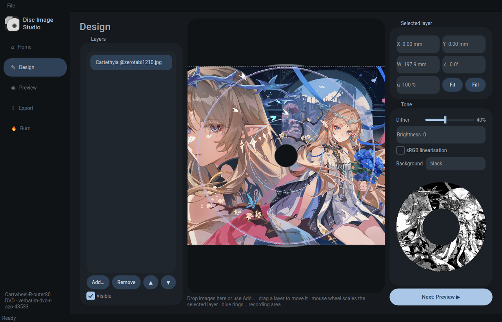
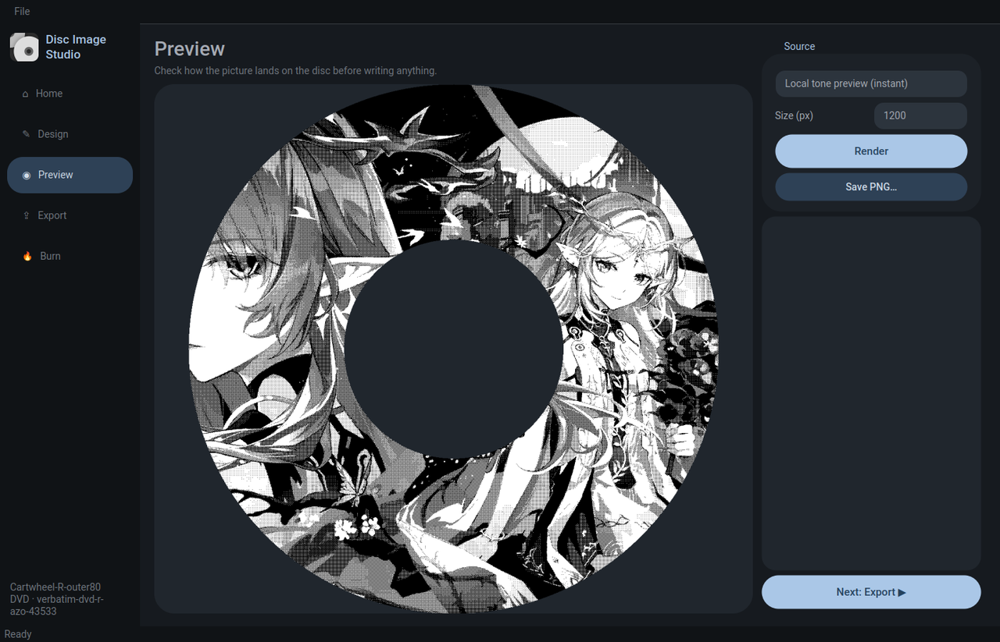
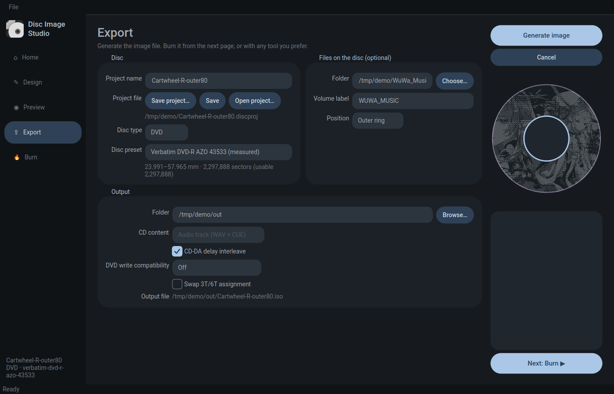
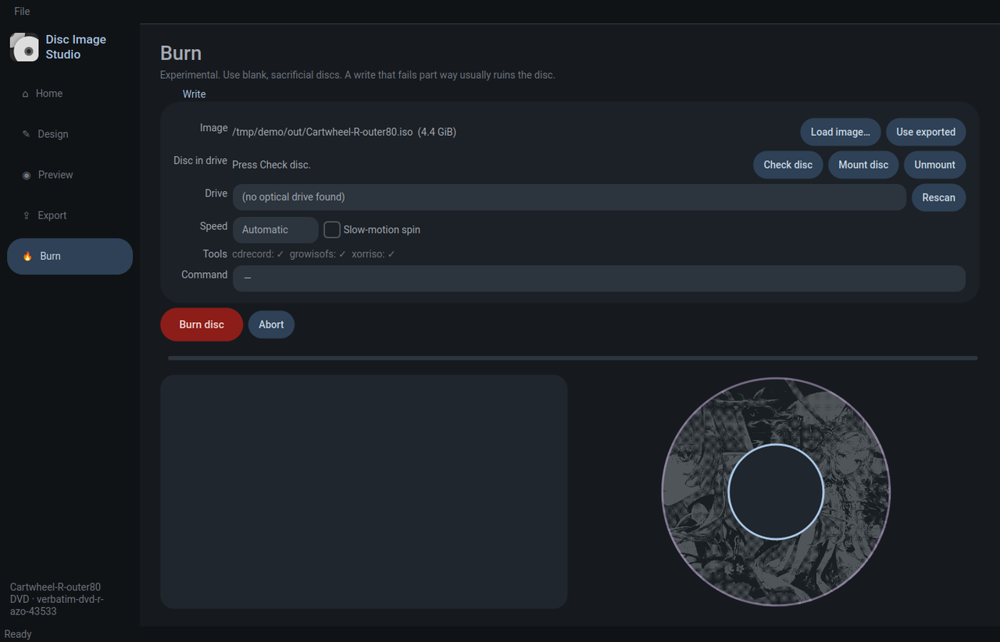

<div align="center">

[简体中文](../README.md) | [繁體中文](../README.zh-TW.md) | **English** | [日本語](../README.ja.md) | [Türkçe](../README.tr.md) | [Español](../README.es.md) | [Čeština](../README.cs.md) | [Português (Brasil)](../README.pt-BR.md)


<h2>An all-in-one tool for generating and burning visible images onto optical discs</h2>

Disc Image Studio is a multi-platform tool for generating and burning disc-surface images. It lets you etch pictures that are visible to the naked eye onto DVD, CD and single-layer Blu-ray discs with any recorder.


[](https://github.com/JiaFeiMiao-K-Cat/DiscImageStudio)
[](../LICENSE)

<a href="https://discord.gg/rHkD2g7ufH"></a>

</div>

---

> **This is a fork of [Disc Image Studio](https://github.com/JiaFeiMiao-K-Cat/DiscImageStudio).** It adds a native
> **Linux GUI** on the [`linux-gui` branch](https://github.com/Eagle10021/DiscImageStudio/tree/linux-gui/linux-gui); everything else is unchanged upstream code.
> This page is a grammar-edited copy of upstream's `README.en.md`, shown as the front page of the fork. The original
> Chinese and English READMEs are still in the repository root.


## Results

<p align="center">
  
  <a href="https://github.com/JiaFeiMiao-K-Cat/DiscImageStudio/issues/61"></a>
  
</p>

---

## Overview

Disc Image Studio converts an image into data that satisfies the physical-layer constraints of CD, DVD and single-layer BD-R discs. After burning, the disc surface shows a pattern that is visible to the naked eye.

## Interface Preview


---

## Linux GUI (this fork)

A native desktop front-end for Linux with the same **Design → Preview → Export → Burn** workflow as the Windows app: a layer
canvas with drag and drop, tone controls with a live preview, CD / DVD / Blu-ray export with the built-in disc presets, disc
detection with automatic preset matching, and burning through `growisofs` / `cdrecord` with a live progress bar and a disc
that spins at the drive's real RPM. It follows your Material You colours and adapts to any window size.

<table>
<tr>
<td width="50%"><br><sub><b>Design</b> — layer canvas with drag and drop, tone controls and a live black-and-white preview</sub></td>
<td width="50%"><br><sub><b>Preview</b> — how the picture lands on the disc before anything is written</sub></td>
</tr>
<tr>
<td width="50%"><br><sub><b>Export</b> — disc presets, stored files on the inner or outer ring, project save and open</sub></td>
<td width="50%"><br><sub><b>Burn</b> — disc detection, preset matching, live progress and a disc that spins at the drive's RPM</sub></td>
</tr>
</table>

```sh
git checkout linux-gui
# Arch Linux
sudo pacman -S dotnet-sdk python-pyqt6 python-numpy dvd+rw-tools cdrtools
./linux-gui/install.sh
disc-image-studio-gui
```

Details, tips from real burns and the code layout: [`linux-gui/README.md`](https://github.com/Eagle10021/DiscImageStudio/tree/linux-gui/linux-gui/README.md).

---

## Quick Start

On Windows x64, download and run the file ending in `win-x64.exe`; on Windows 11 ARM64, choose the native `win-arm64.exe` build. On Linux or macOS, download the **experimental CLI** archive for your CPU, extract it and run `./disc-image-studio --help`. Each release package includes the .NET runtime. [GitHub Releases](https://github.com/JiaFeiMiao-K-Cat/DiscImageStudio/releases)

### 1. Create a Project

On the home page, choose CD, DVD or Blu-ray, pick an output location and create the project.

### 2. Design the Disc Surface

On the Design page, click **Import images**, or drag one or more images onto the page from your file manager. PNG, JPEG, BMP, TIFF and GIF are supported, as is `.svg` vector artwork up to 32 MiB. Arrange the images as layers, then adjust dithering, gamma, brightness and grayscale levels in the **Tone** panel on the right.

Vector `.svg` layers stay sharp and keep their `viewBox` proportions while you edit, and are rasterized on demand for preview and export. SVG parsing uses `SharpVectors`, which ignores external resources and scripts. Complex `<filter>` effects, masks and advanced CSS class selectors may be degraded or ignored, so flattened static-path SVGs are recommended.

### 3. Preview and Export

Check the disc projection on the Preview page, then generate an ISO, RAW or WAV+CUE file on the Export page. Alternatively, use live burning to write directly to a blank disc.

Live burning is experimental. Use only expendable test discs.

## Features

### Disc Data Generation

- **CD support**: Works with any CD. Export WAV audio tracks with proper headers and matching CUE files, compatible with burning software such as cdrecord and ImgBurn. RAW audio export is also available. See [CD burning compatibility](../docs/CD_AUDIO_COMPATIBILITY.md).
- **DVD support**: Works with any DVD. Export ISO images.
- **Blu-ray support**: Supports single-layer 25 GB BD-R discs, with a drawing-only mode and UDF 2.01 file output. See [ADDING_BLURAY.md](../docs/ADDING_BLURAY.md).
- **Files on disc**: For CD, DVD and Blu-ray, choose a folder and place its files on the inner or outer ring, either from the Design page or on the Export page. The settings are saved with the project.
- **File region preview**: Design projections and readback of hybrid discs show the file region, including the file system, in blue.
- **Media grayscale schemes**: CD and DVD both use two black-and-white levels: `0D / AA` for CD and `A5 / 92` in the DVD scrambled domain. See [PHYSICAL_MODEL_AUDIT.md](../docs/PHYSICAL_MODEL_AUDIT.md).
- **Grayscale dithering tool**: A standalone program can also turn a source image into a two-level `0/255` black-and-white PNG. You can open or drag in source images, compare them side by side, and export lossless PNGs. See the [usage and build instructions](../tools/FourLevelDither/README.md).
- **Disc presets**: Built-in disc parameters cover several brands of CD, DVD and BD. You can also contribute your own calibrated data; see [preset maintenance](../docs/DISC_PRESETS.md).

### Assisted Calibration

Disc Image Studio provides an assisted calibration workflow. Compared with manual visual calibration, the assisted algorithm improves the precision of the measurable disc-surface parameters from 10<sup>-6</sup> to 10<sup>-14</sup>. Before calibration, a constant track pitch produces noticeably curved radial crosshair lines. After you regenerate and burn the image with the cubic track-pitch parameters obtained through assisted calibration, the lines are much closer to straight radial lines.

| Before calibration · Constant track pitch | After calibration · Cubic track pitch |
| --- | --- |
|  |  |
| `P20261004-133519.jpg` | `P20261004-135416.jpg` |


For your first calibration, follow the [DVD calibration walkthrough for Verbatim AZO DVD-R](../docs/CALIBRATION_TUTORIAL.en.md), which shows the photos, measurement points and results of all three stages. The [assisted calibration guide](../docs/CALIBRATION.en.md) describes the complete workflow and all parameters.

### Burning

- **Disc image output**: Export complete ISO / RAW files and burn them manually with suitable burning software.
- **Live streaming burn (experimental)**: Generate and burn CD, DVD and BD-R data at the same time, without saving a complete disc image. BD-R uses MMC sequential writing.
- **Do not use non-blank discs.**

## System and Hardware Requirements

- The x64 desktop app requires Windows 10 2004 (2004/20H1, 19041) or later, or Windows 11. The ARM64 app requires Windows 11. Native ARM64 CI covers software self-tests and GUI snapshots; physical disc burning on ARM64 remains unverified.
- Building: .NET 10 SDK (`global.json` pins 10.0.x). A non-self-contained GUI built from source requires the .NET 10 Windows Desktop Runtime. The Release EXE includes the runtime, so a separate .NET installation is unnecessary.
- Live burning requires a CD / DVD / BD recorder recognized by Windows and blank media. BD-R requires a blank single-layer disc that supports sequential writing.

## Build and Run

```powershell
dotnet build DiscImageStudio.slnx --configuration Release
dotnet run --project src/DiscImageStudio.App --configuration Release
```

Build regression checks:

```powershell
dotnet run --project src/DvdImageSolver --configuration Release -- selftest
dotnet run --project tests/DiscImageStudio.ArchitectureTests --configuration Release
```

See the [release guide](../docs/RELEASING.md) for versioning rules, CI-generated EXEs, release draft checks, MSIX packaging, and signing procedures.

## Command Line

On Linux with glibc, choose `linux-x64` or `linux-arm64`. On macOS, choose `osx-arm64` for Apple Silicon or `osx-x64` for Intel. The CLI writes image files and audio tracks that you can burn with a compatible tool.

Run the CLI from source with the .NET 10 SDK:

```sh
dotnet run --project src/DiscImageStudio.Cli -c Release -- --help
```

The CLI reads PNG, JPEG, BMP and GIF files, using the first frame of animated images. To check your installation, generate a two-sector audio track and its matching CUE sheet:

```sh
./disc-image-studio cd-generate --input picture.png --output sample.wav --sectors 2
```

| Command | Description |
| --- | --- |
| `solve` | Generate a DVD image using fixed fast texture mapping (CW direction), with optional dithering to mix black and white textures |
| `encode` | Encode a single DVD ECC block into NRZI channel levels |
| `calibrate` | Calibration projection: sample the DVD source image using the generation geometry and project it onto the disc using the measured geometry |
| `simulate` | Simulate readback of a generated DVD ISO using measured radii |
| `selftest` | Run deterministic regression self-tests for the DVD engine |
| `cd-generate` | Generate WAV + CUE / RAW audio tracks when no files are included on the disc; generate a CD data disc ISO when `--data-dir` is specified |
| `cd-preview-warp` | Calibration projection: project the CD source image using measured geometry |
| `cd-preview-track` | Render an existing WAV or RAW CD-DA audio track using calibrated geometry (readback simulation) |
| `bd-generate` | Generate a complete BD-R ISO and write an `<iso>.json` sidecar |
| `bd-info` / `bd-probe` / `bd-encode` | Export BD parameters, raw payload probes, or diagnostics for a single ECC cluster |

See the documentation for each command for its full list of parameters.

## Source Layout

```text
src/DiscImageStudio.Cli/     Offline Linux and macOS command-line host
src/DiscImageStudio.ImageIO/ WIC and cross-platform image codecs
src/DiscImageStudio.Core/    Media-independent module contracts, project/preset models, job and command catalog
src/DiscImageStudio.Imaging/ Image preprocessing and dithering helpers shared by CD/DVD/BD
src/DiscImageStudio.Burning/ Windows IMAPI2 device enumeration, stream buffering, and safe burning layer
src/DiscImageStudio.Cd/      CD-DA generation core and CD module
src/DiscImageStudio.Dvd/     DVD engine adapter module
src/DiscImageStudio.BluRay/  BD-R geometry, 17PP/ECC, 3T/6T mapping, streaming generation, and ISO
src/DiscImageStudio.Iso/     UDF 2.01 / ISO9660 writers
src/DiscImageStudio.App/     WPF GUI, unified command line, and Store assets
src/DvdImageSolver/          Isolated DVD encoding/solving engine
tests/                       Architecture regression tests without a third-party test framework
packaging/                   MSIX manifest and packaging scripts
tools/                       Standalone utilities and asset generation scripts
docs/                        Architecture, engine, preset, release, and other documentation
```

## Documentation

| Document | Contents |
| --- | --- |
| [ARCHITECTURE.md](../docs/ARCHITECTURE.md) | Module abstractions, boundaries between layers, and extension rules |
| [LOCALIZATION.md](../docs/LOCALIZATION.md) | Language settings and translation resource maintenance |
| [DVD_ENGINE.md](../docs/DVD_ENGINE.md) | DVD NRZI image constraint solver conventions, encoding chain, and self-test coverage |
| [CD_AUDIO_COMPATIBILITY.md](../docs/CD_AUDIO_COMPATIBILITY.md) | CD audio track formats, byte order, and ghosting troubleshooting |
| [ADDING_BLURAY.md](../docs/ADDING_BLURAY.md) | Blu-ray module physical model, generation/burning pipeline, and extension points |
| [DISC_PRESETS.md](../docs/DISC_PRESETS.md) | Layered JSON format and merging rules for editable disc presets |
| [CALIBRATION.en.md](../docs/CALIBRATION.en.md) | Photo rectification (marking the disc’s outermost physical edge and center-hole edge), curve calibration, and DVD cubic track-pitch fitting |
| [CALIBRATION_TUTORIAL.en.md](../docs/CALIBRATION_TUTORIAL.en.md) | Verbatim AZO DVD-R walkthrough with actual records, measurement points, and results after fine calibration |
| [PHYSICAL_MODEL_AUDIT.md](../docs/PHYSICAL_MODEL_AUDIT.md) | Review of the CD / DVD generation physical models |
| [VALIDATION.md](../docs/VALIDATION.md) | Local validation records for builds, regressions, and physical disc tests |
| [RELEASING.md](../docs/RELEASING.md) | GitHub Releases, MSIX packaging, signing tests, and Store submission procedures |
| [CHANGELOG.md](../CHANGELOG.md) | Version change history |

## Reference Standards

Disc Image Studio’s implementation and physical models primarily reference the following specifications:

| Media | Standard and edition | Scope used by this project |
| --- | --- | --- |
| CD-R | [ECMA-394, 1st edition, December 2010](https://ecma-international.org/publications-and-standards/standards/ecma-394/) — *Recordable Compact Disc Systems CD-R Multi-Speed* ([official PDF](https://ecma-international.org/wp-content/uploads/ECMA-394_1st_edition_december_2010.pdf)) | CD-R media, multi-speed recording, and CD-DA compatibility; this project generates CD-DA audio tracks. |
| DVD common format / DVD-ROM | [ECMA-267, 3rd edition, April 2001](https://ecma-international.org/publications-and-standards/standards/ecma-267/) — *120 mm DVD – Read-only disk* ([official PDF](https://ecma-international.org/wp-content/uploads/ECMA-267_3rd_edition_april_2001.pdf)) | DVD data frames, ECC, EFMPlus encoding, and the Annex G conversion tables; ECMA-359 is also referenced for recordable-media rules. |
| DVD-R | [ECMA-359, 1st edition, December 2004](https://ecma-international.org/publications-and-standards/standards/ecma-359/) — *80 mm (1,46 Gbytes per side) and 120 mm (4,70 Gbytes per side) DVD Recordable Disk (DVD-R)* ([official PDF](https://ecma-international.org/wp-content/uploads/ECMA-359_1st_edition_december_2004.pdf)) | Single-layer DVD-R geometry, sectors, error correction, and encoding; the standard covers single-sided and double-sided media. Double-sided does not mean dual-layer. |
| BD-R | [ISO/IEC 30190:2021, 3rd edition, January 2021](https://www.iso.org/standard/80770.html) — Specification for information interchange and storage on 120 mm single-layer (25.0 GB) and dual-layer (50.0 GB) recordable BD | The experimental mode uses the track and sector layout, error correction, and encoding for single-layer 25 GB discs. Dual-layer discs are not currently supported. |

The common CD encoding components also reference [ECMA-130, 2nd edition (CD-ROM, 1996)](https://ecma-international.org/publications-and-standards/standards/ecma-130/).

## Burning and Media Safety

- Disc Image Studio does not install drivers or services. Live burning uses Windows’ built-in IMAPI2 and rejects non-blank media.
- Live burning has received some feedback from physical disc tests, but validation coverage across different devices, media, and burning paths remains limited. It is experimental; use only expendable test media. Interrupted burning, power loss or insufficient generation speed can still ruin a disc.
- The actual visible result depends on the disc, recorder, firmware, and write strategy.
- For hybrid discs, the source folder is scanned and its layout is fixed before burning starts. If a source file’s size changes during the operation, the job is safely terminated; a disc that has already started writing may still become unusable.
- BD-R sequential writing does not provide spare-area remapping. After an interruption, writing to the same disc generally cannot continue.

## Privacy and Security

- Except when the user manually checks for updates on the About page, Disc Image Studio does not access the network, upload files, or collect telemetry. See the [privacy policy](../PRIVACY.md).
- Do not disclose security issues in public issues. Follow the [security policy](../SECURITY.md) and use GitHub’s private reporting feature.

## Contributing

Issue reports and code contributions are welcome. See the [contributing guide](../CONTRIBUTING.md) for development environment setup, module boundary rules, testing requirements, and the pull request process.

## License

This project is licensed under the [GNU GPL v3.0 or later](../LICENSE) (`GPL-3.0-or-later`). The CD interleaving implementation includes code ported and modified from CDImage, and the project as a whole is distributed under a compatible GPL license.

Distributing binaries or modified versions requires you to comply with the corresponding-source requirements and the other conditions of the license. Third-party fonts and components keep their own licenses; see the [license notice](../LICENSE-NOTICE.md) and the [third-party notices](../THIRD-PARTY-NOTICES.txt). The full texts are also available offline on the app’s About page.

## Acknowledgments

Thanks to [arduinocelentano’s CDImage project](https://github.com/arduinocelentano/cdimage), which demonstrated how to create visible images on a disc surface by generating CD audio tracks. This project’s CD interleaving implementation was ported from its related code and further modified, and the approach to drawing on CD surfaces was also inspired by it. The work of CDImage’s original author and contributors provides an important foundation for this project.

---

## Upstream Star History

<a href="https://www.star-history.com/?repos=jiafeimiao-k-cat%2Fdiscimagestudio&type=date&legend=top-left">
 <picture>
   <source media="(prefers-color-scheme: dark)" srcset="https://api.star-history.com/chart?repos=jiafeimiao-k-cat/discimagestudio&type=date&theme=dark&legend=top-left" />
   <source media="(prefers-color-scheme: light)" srcset="https://api.star-history.com/chart?repos=jiafeimiao-k-cat/discimagestudio&type=date&legend=top-left" />
   
 </picture>
</a>
