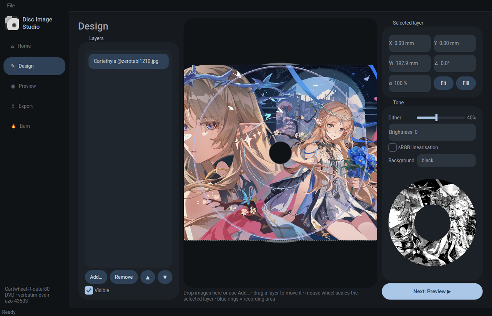
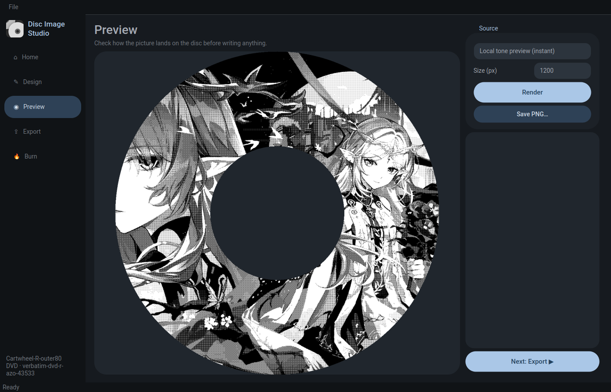
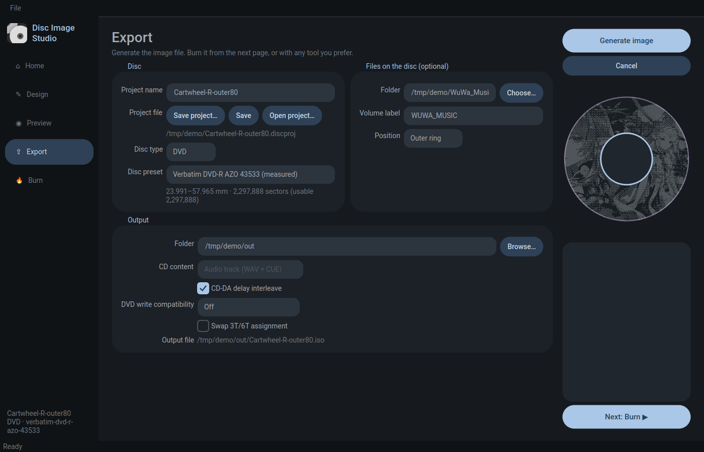
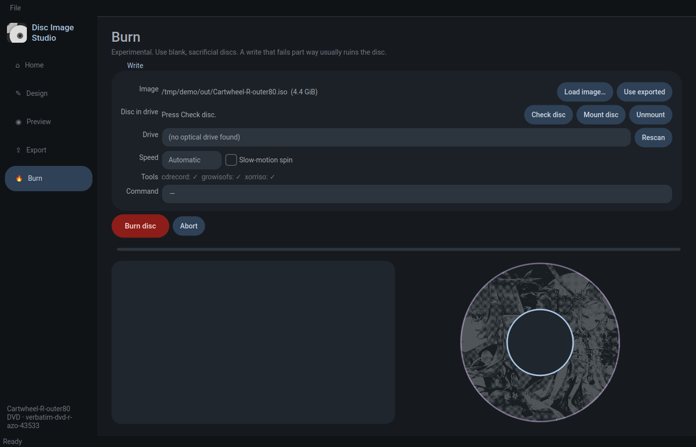

# Disc Image Studio for Linux

A PyQt6 desktop front-end for the Disc Image Studio command-line encoders. It gives Linux the same workflow as the
Windows app: **Design → Preview → Export → Burn**.

> The Windows GUI (WPF) and the IMAPI burner are Windows-only. This front-end drives the portable CLI in `src/`
> and burns with `growisofs` / `cdrecord`. Burning is experimental: use expendable discs.

## Screenshots

<table>
<tr>
<td width="50%"><br><sub><b>Design</b> — layer canvas with drag and drop, tone controls and a live black-and-white preview</sub></td>
<td width="50%"><br><sub><b>Preview</b> — how the picture lands on the disc before anything is written</sub></td>
</tr>
<tr>
<td width="50%"><br><sub><b>Export</b> — disc presets, stored files on the inner or outer ring, project save and open</sub></td>
<td width="50%"><br><sub><b>Burn</b> — disc detection, preset matching, live progress and a disc that spins at the drive's RPM</sub></td>
</tr>
</table>

## Features

- **Design** — layer canvas (drag, scroll to scale, rotate, opacity, order), drag-and-drop images, dither / brightness /
  gamma / grey levels with a live black-and-white preview, ring guides and a shaded band for stored files.
- **Preview** — instant local tone preview, the encoder's geometry projection, and read-back of an exported image.
- **Export** — CD (WAV+CUE or Mode 1 ISO), DVD and Blu-ray images with the built-in disc presets, optional files stored
  on the disc (inner or outer ring), project save/open (works on network shares), load an existing image.
- **Burn** — detects the disc in the drive (type, media ID, blank/written, capacity) and suggests the matching preset,
  warns when an image was made for a different disc, live progress with a **wavy progress bar** and a disc that spins at
  the drive's real RPM, mount / unmount buttons.
- **Safe tail + `Burn info.txt`** (DVD) — the last few MiB are written as ordinary, readable data so drives and players can read the end of the
  disc, and a real text file there records the project, the machine and system that made it, and later the drive, disc and speed it was burnt
  with. The **Disc note** button reads it back from the disc.
- **Material 3 Expressive** look driven by your Material You colours (reads `~/.config/kdeglobals`, follows wallpaper and
  light/dark changes live).
- Adaptive layout: no scroll bars; it tightens spacing and collapses the side rail as the window shrinks.

## Install

Requirements: .NET 10 SDK, Python 3.11+, PyQt6, numpy; `growisofs` (dvd+rw-tools) for DVD/BD and `cdrecord` (cdrtools)
for CD.

```sh
# Arch
sudo pacman -S dotnet-sdk python-pyqt6 python-numpy dvd+rw-tools cdrtools
./linux-gui/install.sh
disc-image-studio-gui
```

## Tips from real burns

- A picture mostly in black and white with **dither 0–40 %** shows far more clearly than a busy photo.
- Rewritable DVD+RW gave darker blacks than DVD-R in testing; results depend on disc, drive and write speed.
- With files at the **inner ring**, set **Safe tail** (32 MiB is about 0.2 mm of picture) so the end of the disc is readable; with files on the
  **outer ring** the tail is the files, so the setting is off.
- Put stored files on the **outer ring**: with files at the inner ring the system could not identify the disc
  (the last sectors were unreadable), with the outer ring it mounted normally.
- If a disc's picture area is slow to read and the desktop will not mount it, run `sudo linux-gui/setup-disc-mount.sh`
  once, then use the **Mount disc** button or `mount ~/disc`.
- File names on the disc are cut to 64 characters (a limit of the filesystem the encoder writes).

## Layout

| Path | Purpose |
| --- | --- |
| `discstudio/` | the application (`core.py` project model + CLI arguments, `compose.py` layers, `theme.py` M3E, `app.py` UI) |
| `discstudio/presets.json` | copy of the upstream built-in disc presets |
| `templates/make_dvd_template.py` | generates a layered PSD template of the disc for Affinity Photo / Photoshop |
| `install.sh`, `setup-disc-mount.sh` | installer and the optional mount helper |

## Licence and credits

GPL-3.0-or-later, like the project it builds on. The encoders, disc presets and logo come from
[Disc Image Studio](https://github.com/JiaFeiMiao-K-Cat/DiscImageStudio) (see `discstudio/assets/NOTICE.txt`).
This front-end is an independent Linux contribution and is not an official release of that project.
